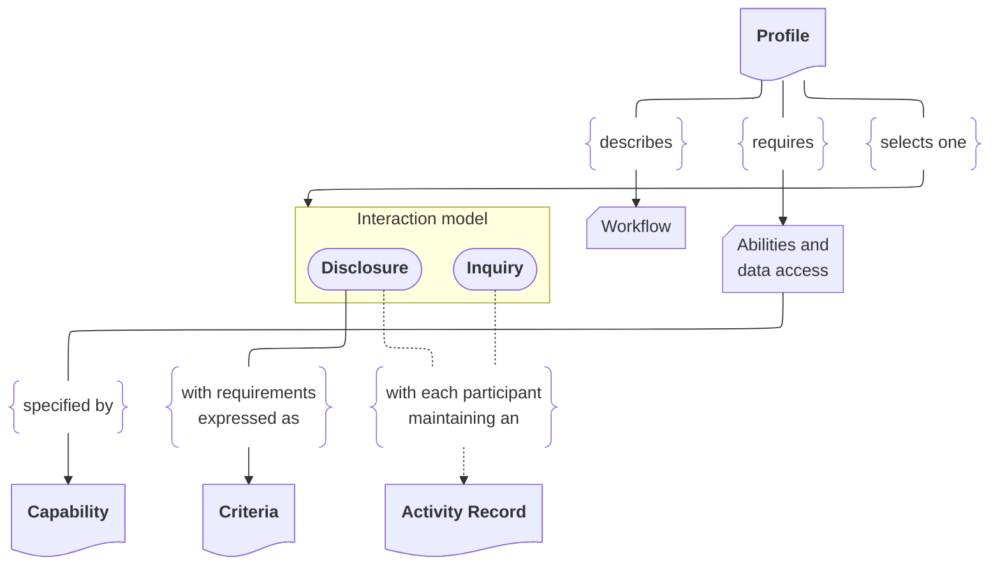

# Conversational Interoperability (COIN)

Conversational Interoperability (COIN) is an approach to healthcare
interoperability in which AI agents act on behalf of people and organizations to
exchange and interpret information and coordinate workflows. An agent is
software that uses AI to interpret information and take authorized actions, such
as retrieving records or asking another service to explain a requirement.

Agents can clarify information needs, find relevant information in their
respective systems, resolve differences in how that information is represented
or understood, and exchange it in a form the recipient can use. They can use
structured exchanges, natural-language dialogue, or both, depending on the task.

This approach could reduce repeated manual work and the effort needed to build
and maintain custom integrations, helping organizations adapt more readily as
systems, requirements, and workflows change.

The proposed specification builds on existing standards, APIs, and data sources.
It defines shared expectations for agent behavior, interactions, and outputs.
It aims to combine the flexibility of AI with the predictability, transparency,
and accountability needed for safe and reliable healthcare interoperability.

## Initial focus

The initial focus is on helping people and organizations understand evaluation
requirements and prepare the data and evidence needed for that evaluation.

In prior authorization, for example, a provider’s agent asks a payer’s agent
which requirements apply to a requested service and clarifies what evidence is
needed. The provider’s agent then gathers relevant patient information,
assesses it against those requirements, and identifies missing or conflicting
evidence for review.

Similar preparation tasks arise in quality measurement, clinical trial
matching, and specialist referrals. Each workflow would define the
required outputs, how findings are reviewed and used, and who makes subsequent
decisions.

## Specification

The specification describes how interaction models and artifacts fit together.
Its guidance covers common data representation rules and approaches to assessing
implementations.

While this initial specification is under development, it uses the version
identifier `draft`.

### Interaction Models

This proposal presents two distinct interaction models for information
exchange. In one, evaluation requirements are supplied upfront to guide an agent
in gathering and assessing evidence. In the other, an iterative exchange of
questions and answers from either participant guides what they retrieve, explain,
and ask next. Each model describes what participants are expected to do, what
they exchange, and how they coordinate their work. Each Profile selects one model.

#### Disclosure

[Disclosure](disclosure/index.md) is an interaction model that helps people and
organizations prepare evidence for an evaluation. The applicable requirements
are supplied upfront as
[Criteria](criteria/index.md), giving the agent preparing evidence a basis for
deciding what information to gather and how to assess it.

The Preparer is the agent preparing the evidence. It gathers relevant
information, records findings and gaps, and asks for clarification when needed.
The Evaluator supplies the Criteria and explains their meaning on behalf of the
person or organization responsible for the evaluation. The Disclosure protocol
defines their exchanges, including optional checks of individual evidence items.

#### Inquiry

[Inquiry](inquiry/index.md) is a proposed interaction model based on an iterative
exchange of questions and supported answers. Either participant can ask
questions, seek clarification, or request supporting evidence. The conversation
guides what information to retrieve and what to ask next. Participants make gaps
and uncertainty clear.

The Preparer gathers information and prepares supported answers and evidence.
The Evaluator asks and refines questions and reviews the information supplied.
Inquiry can support this exchange without a predefined set of evaluation
requirements.

### Artifacts

Artifacts are the descriptions and records that participants use or produce as
they carry out work with COIN. Their shared definitions help participants
interpret and use information consistently, even when they work across different
systems and organizations.

#### Profile

A [Profile](profile/index.md) gives people and agents directions for a workflow
and describes how COIN fits within it. It identifies participant roles, their
responsibilities, the sequence of activities, and the information exchanged.
It specifies the use of data sources, APIs, and standards, along with review and
decision points, handoffs, and safeguards.

Different organizations and evaluating programs can use the same Profile when
they share its workflow and required data. Participating organizations take on
its roles and provide the required services and data access.

Each Profile uses either [Disclosure](disclosure/index.md) or
[Inquiry](inquiry/index.md). A single agent may support both models and follow
different Profiles for different tasks. The selected Profile tells it how to act
in its assigned role and what to expect from other participants.

For example, a prior authorization Profile can describe the workflow for
preparing, submitting, evaluating, and responding to a request, and identify the
steps supported by COIN.

#### Capability

A [Capability](capability/index.md) specifies an ability or data access guarantee
that an implementation must provide to an agent. It can require access to a
particular API or an ability such as submitting a FHIR Bundle to a designated
endpoint. Profiles define the required Capabilities, their scope and conditions,
and the participant roles that need them. Implementations choose how to provide
them unless the Profile specifies an interface.

#### Criteria

[Criteria](criteria/index.md) represents evaluation requirements as readable
statements with explicit logical relationships. It identifies individual
requirements so agents can connect evidence, findings, and clarification requests
to what is being assessed. Disclosure uses this representation to supply
requirements upfront.

#### Activity Record

An [Activity Record](activity-record/index.md) documents a participant's work,
linking relevant actions and exchanges to the information used, outputs produced,
and limitations encountered. It supports audit and transparency by giving
authorized reviewers a basis for examining those results. Each participant
maintains a record of its work.

### Guidance

Implementation guidance covers common data representation requirements and
approaches to assessing conformance.

#### Data Conventions

Shared data types and JSON representation rules used throughout the
specification are defined in [Data Conventions](conventions/index.md).

#### Conformance

[Conformance](conformance/index.md) explores ways to assess whether an
implementation meets COIN and Profile requirements. It considers checks of
Capabilities, Preparer and Evaluator behavior, and the complete workflow,
including review and handoff.

## Copyright and trademarks

©2026 The MITRE Corporation. ALL RIGHTS RESERVED. Approved for Public Release; Distribution Unlimited. Public Release Case Number 26-2020

Third-party standards and terminology are subject to their respective copyright
and licensing terms. [HL7® and FHIR®](https://hl7.org/fhir/R5/license.html) are
registered trademarks of Health Level Seven International.
[SNOMED CT®](https://www.snomed.org/get-snomed) is copyright SNOMED International.
References do not imply endorsement.
